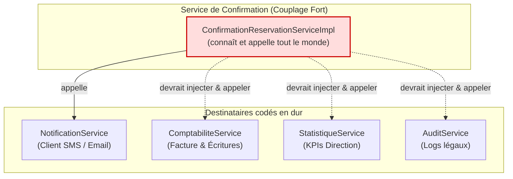
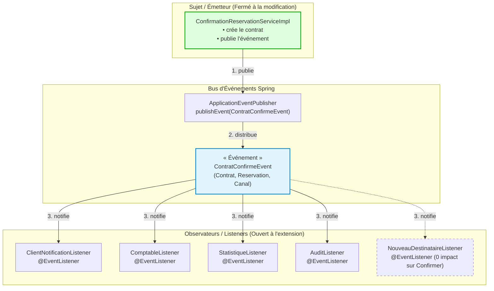

# Atelier 7 — Du code propre au code évolutif : les patrons GoF

## Mission 4 : Le comptable veut être prévenu

---

### 1. Analyse du Problème Initial (Pourquoi le problème se pose dans AutoLoc)

À l'issue de l'Atelier 6, le code de l'agence AutoLoc a été découpé en services métier plus cohésifs. Cependant, lors de la confirmation d'une réservation, la méthode d'orchestration se terminait ainsi :

```java
Contrat cree = contratService.create(c);
notificationService.notifier(r.getClient(), canal, "Contrat " + cree.getId() + " confirmé");
return cree;
```

#### Le constat métier et l'effet boule de neige :
1. Initialement, seul le client devait être notifié par SMS ou Email.
2. Rapidement, le **comptable** demande à être prévenu immédiatement pour émettre la facture et enregistrer l'écriture de vente.
3. Puis la **direction** exige la mise à jour en temps réel des statistiques et indicateurs de performance (KPIs d'occupation du parc).
4. Puis le service d'**audit** réclame une journalisation immuable de conformité légale pour chaque contrat validé.
5. Demain, le marketing voudra synchroniser le CRM, le service flotte voudra préparer le véhicule, etc.

#### Pourquoi cette approche directe pose un problème majeur :
- **Couplage fort et violation de l'Open/Closed Principle (OCP)** : À chaque nouveau service intéressé, les développeurs sont obligés de rouvrir et modifier la classe de confirmation, d'y injecter un nouveau service (`IComptabiliteService`, `IStatistiqueService`, `IAuditService`...) et d'ajouter une ligne d'appel explicite. La classe de confirmation ne devrait pourtant avoir qu'une mission : confirmer la réservation et persister le contrat.
- **Violation du Single Responsibility Principle (SRP)** : Le service de confirmation assume désormais la responsabilité de coordonner tout le reste de l'entreprise (finance, direction, audit, communication client).
- **Risque d'effet domino et couplage transactionnel/temporel** : Si l'audit ou l'envoi d'email échoue (serveur externe indisponible) ou subit une latence réseau, cela bloque ou fait échouer l'ensemble de la transaction de confirmation du client, alors que ces actions secondaires sont de simples effets de bord.
- **Explosion des dépendances du constructeur (Constructor Bloat)** : La classe de confirmation accumule un nombre déraisonnable de dépendances injectées.

---

### 2. Le Patron de Conception Découvert

#### 2.1. Nom et famille du patron
- **Nom du patron** : **Observer** (Observateur / Publish-Subscribe / Écouteur d'événements).
- **Famille GoF** : **Patrons de Comportement** (*Behavioral Design Patterns*).

#### 2.2. Définition dans nos propres mots
> *« Le patron Observateur définit une relation de dépendance un-à-plusieurs entre des objets, de sorte que lorsqu'un objet (le Sujet ou Publisher) accomplit une action clé ou change d'état, tous les objets dépendants abonnés (les Observateurs ou Listeners) en sont notifiés et mis à jour automatiquement, sans que le sujet n'ait besoin de connaître leur identité, leur type exact ni leur nombre. »*

#### 2.3. Explication détaillée & Rôles dans AutoLoc
Le patron Observer résout précisément le dilemme d'AutoLoc en inversant le sens de la dépendance grâce à un modèle orienté événements :
1. **Le Sujet / Publisher (`ConfirmationReservationServiceImpl`)** :
   Il se contente de publier un événement métier (`ContratConfirmeEvent`) dès que le contrat est persisté. Il ignore totalement qui l'écoute.
2. **L'Événement (`ContratConfirmeEvent`)** :
   Un objet de transfert immuable contenant l'état pertinent du contrat créé, la réservation associée et le canal d'origine.
3. **Le Médiateur d'événements (Le bus Spring `ApplicationEventPublisher`)** :
   Composant d'infrastructure fourni par Spring qui relaie l'événement publié vers tous les abonnés éligibles.
4. **Les Observateurs concrets (`@EventListener`)** :
   - `ClientNotificationListener` : Envoie l'email/SMS au client via `INotificationService`.
   - `ComptableListener` : Déclenche l'écriture comptable et la facturation.
   - `StatistiqueListener` : Met à jour les tableaux de bord et métriques de la direction.
   - `AuditListener` : Consigne la trace légale et l'horodatage de conformité.

#### 2.4. Quel mécanisme de Spring a servi à le mettre en œuvre ?
Spring Boot implémente nativement le patron Observer sans nécessiter de gestion manuelle de collection d'observateurs :
- **`ApplicationEventPublisher`** : L'interface Spring injectée dans le service pour publier les événements (`publishEvent(...)`).
- **`@EventListener`** : L'annotation posée sur n'importe quelle méthode d'un composant Spring (`@Component`) pour la transformer automatiquement en Observateur abonné au type d'événement passé en paramètre.
- **`@TransactionalEventListener(phase = TransactionPhase.AFTER_COMMIT)`** *(variante recommandée pour la production)* : Permet de ne déclencher les observateurs (comptabilité, audit, email) que si et seulement si la transaction de base de données de confirmation a été validée avec succès (*committed*).
- **`@Async`** : Permet aux observateurs non-bloquants (ex. audit, statistiques) d'être exécutés sur un pool de threads séparé pour ne pas pénaliser le temps de réponse utilisateur.

#### 2.5. Lien avec l'Atelier 6 : Les principes SOLID respectés
- **OCP (Open/Closed Principle - Principe Ouvert/Fermé)** :
  C'est le gain fondamental de cette mission. La classe de confirmation est désormais **fermée aux modifications** : pour ajouter un 5ᵉ destinataire (ex: `CrmListener`), on ne touche à aucune ligne de code existante. Le système est **ouvert aux extensions** : il suffit d'écrire une nouvelle classe annotée `@Component` avec un `@EventListener`.
- **SRP (Single Responsibility Principle)** :
  `ConfirmationReservationServiceImpl` n'a plus qu'une seule responsabilité : valider et créer le contrat. Chaque observateur gère isolément son propre domaine de compétence.
- **DIP (Dependency Inversion Principle)** :
  La classe de haut niveau (confirmation) ne dépend plus d'une multitude de services de bas niveau (comptabilité, mail, audit). Tous dépendent désormais d'une abstraction commune : le contrat de données représenté par l'événement `ContratConfirmeEvent`.

---

### 3. Schéma de la Solution (Avant et Après)

#### 3.1. AVANT : Couplage direct et violation d'OCP



*Constat AVANT : Toute nouvelle exigence impose de modifier la signature, le constructeur et le corps de `ConfirmationReservationServiceImpl`.*

---

#### 3.2. APRÈS : Patron Observer avec Spring Events (Découplage Total)



---

### 4. Proposition de Code Spring Boot

#### 4.1. L'Événement Métier : `ContratConfirmeEvent.java`

```java
package tn.esprit.manaiamal4cce11.events;

import lombok.Getter;
import tn.esprit.manaiamal4cce11.domain.Contrat;
import tn.esprit.manaiamal4cce11.domain.Reservation;

import java.time.LocalDateTime;

/**
 * Objet immuable transportant l'état lors de la confirmation d'un contrat.
 */
@Getter
public class ContratConfirmeEvent {

    private final Contrat contrat;
    private final Reservation reservation;
    private final String canalNotification;
    private final LocalDateTime dateConfirmation;

    public ContratConfirmeEvent(Contrat contrat, Reservation reservation, String canalNotification) {
        this.contrat = contrat;
        this.reservation = reservation;
        this.canalNotification = canalNotification;
        this.dateConfirmation = LocalDateTime.now();
    }
}
```

---

#### 4.2. L'Interface et le Service de Confirmation (Le Sujet)

##### `IConfirmationReservationService.java`
```java
package tn.esprit.manaiamal4cce11.services;

import tn.esprit.manaiamal4cce11.domain.Contrat;
import tn.esprit.manaiamal4cce11.domain.ModePaiement;

public interface IConfirmationReservationService {
    Contrat confirmer(Long reservationId, ModePaiement mode, String codePromo, String canal);
}
```

##### `ConfirmationReservationServiceImpl.java`
```java
package tn.esprit.manaiamal4cce11.services.impls;

import jakarta.persistence.EntityNotFoundException;
import lombok.RequiredArgsConstructor;
import lombok.extern.slf4j.Slf4j;
import org.springframework.context.ApplicationEventPublisher;
import org.springframework.stereotype.Service;
import org.springframework.transaction.annotation.Transactional;
import tn.esprit.manaiamal4cce11.domain.Contrat;
import tn.esprit.manaiamal4cce11.domain.ModePaiement;
import tn.esprit.manaiamal4cce11.domain.Reservation;
import tn.esprit.manaiamal4cce11.events.ContratConfirmeEvent;
import tn.esprit.manaiamal4cce11.repository.IReservationRepository;
import tn.esprit.manaiamal4cce11.services.IConfirmationReservationService;
import tn.esprit.manaiamal4cce11.services.IContratServices;

import java.math.BigDecimal;
import java.time.LocalDate;

@Slf4j
@Service
@RequiredArgsConstructor
public class ConfirmationReservationServiceImpl implements IConfirmationReservationService {

    private final IReservationRepository reservationRepository;
    private final IContratServices contratService;
    private final ApplicationEventPublisher eventPublisher;

    @Override
    @Transactional
    public Contrat confirmer(Long reservationId, ModePaiement mode, String codePromo, String canal) {
        Reservation r = reservationRepository.findById(reservationId)
                .orElseThrow(() -> new EntityNotFoundException("Réservation introuvable : " + reservationId));

        // 1. Logique métier de création et persistance du contrat
        Contrat c = new Contrat();
        c.setDateSignature(LocalDate.now());
        c.setValide(true);
        c.setReservation(r);
        c.setMontantTotal(BigDecimal.valueOf(150.0));

        Contrat cree = contratService.create(c);

        // 2. Publication de l'événement (Patron Observer)
        // La méthode n'a plus AUCUNE connaissance de ses destinataires !
        eventPublisher.publishEvent(new ContratConfirmeEvent(cree, r, canal));
        log.info("Événement ContratConfirmeEvent publié pour le contrat ID {}", cree.getIdContrat());

        return cree;
    }
}
```

---

#### 4.3. Les Observateurs / Listeners Découplés

##### Observateur 1 : `ClientNotificationListener.java`
```java
package tn.esprit.manaiamal4cce11.events.listeners;

import lombok.RequiredArgsConstructor;
import lombok.extern.slf4j.Slf4j;
import org.springframework.context.event.EventListener;
import org.springframework.stereotype.Component;
import tn.esprit.manaiamal4cce11.events.ContratConfirmeEvent;
import tn.esprit.manaiamal4cce11.services.INotificationService;

@Slf4j
@Component
@RequiredArgsConstructor
public class ClientNotificationListener {

    private final INotificationService notificationService;

    @EventListener
    public void onContratConfirme(ContratConfirmeEvent event) {
        log.info("[Listener - Client] Notification du client pour le contrat ID: {}", event.getContrat().getIdContrat());
        String message = "Contrat " + event.getContrat().getIdContrat() + " confirmé";
        notificationService.notifier(
                event.getReservation().getClient(),
                event.getCanalNotification(),
                message
        );
    }
}
```

##### Observateur 2 : `ComptableListener.java`
```java
package tn.esprit.manaiamal4cce11.events.listeners;

import lombok.extern.slf4j.Slf4j;
import org.springframework.context.event.EventListener;
import org.springframework.stereotype.Component;
import tn.esprit.manaiamal4cce11.events.ContratConfirmeEvent;

@Slf4j
@Component
public class ComptableListener {

    @EventListener
    public void onContratConfirme(ContratConfirmeEvent event) {
        log.info("[Listener - Comptabilité] Contrat confirmé reçu (ID: {}). Montant: {} TND. Émission de l'écriture comptable...",
                event.getContrat().getIdContrat(),
                event.getContrat().getMontantTotal());
        // Traitement comptable : génération de facture et écriture au journal
    }
}
```

##### Observateur 3 : `StatistiqueListener.java`
```java
package tn.esprit.manaiamal4cce11.events.listeners;

import lombok.extern.slf4j.Slf4j;
import org.springframework.context.event.EventListener;
import org.springframework.stereotype.Component;
import tn.esprit.manaiamal4cce11.events.ContratConfirmeEvent;

@Slf4j
@Component
public class StatistiqueListener {

    @EventListener
    public void onContratConfirme(ContratConfirmeEvent event) {
        log.info("[Listener - Direction/Statistiques] Enregistrement métrique pour le contrat ID: {} (Client: {})",
                event.getContrat().getIdContrat(),
                event.getReservation().getClient() != null ? event.getReservation().getClient().getNom() : "Inconnu");
        // Calcul du taux d'occupation et mise à jour du tableau de bord
    }
}
```

##### Observateur 4 : `AuditListener.java`
```java
package tn.esprit.manaiamal4cce11.events.listeners;

import lombok.extern.slf4j.Slf4j;
import org.springframework.context.event.EventListener;
import org.springframework.stereotype.Component;
import tn.esprit.manaiamal4cce11.events.ContratConfirmeEvent;

@Slf4j
@Component
public class AuditListener {

    @EventListener
    public void onContratConfirme(ContratConfirmeEvent event) {
        log.info("[Listener - Audit & Conformité] Trace audit horodatée [{}] : Contrat ID {} validé.",
                event.getDateConfirmation(),
                event.getContrat().getIdContrat());
        // Enregistrement d'un log de conformité infalsifiable
    }
}
```

---

### 5. Tableau des Prompts de la Phase de Découverte

| Prompt (tel quel) | Ce que nous en avons retenu | Ce que nous avons corrigé ou écarté, et pourquoi |
| :--- | :--- | :--- |
| **Prompt 1 :** *« Dans une méthode Spring Boot de confirmation de réservation, chaque fois qu'un contrat est validé, de multiples services doivent être notifiés (client, comptable, audit, statistiques). Actuellement on appelle chaque service directement à la fin de la méthode. Pourquoi cette approche pose-t-elle problème quand l'agence grandit ? »* | L'identification des violations de conception : couplage fort, violation de l'Open/Closed Principle (OCP) et du Single Responsibility Principle (SRP). La classe accumule trop de dépendances et toute modification du workflow externe oblige à rouvrir le code de confirmation. | L'IA proposait initialement de créer un gros service `NotificationManager` appelant séquentiellement tous les services. Nous avons écarté cela car cela ne faisait que déplacer le problème de couplage dans une autre classe sans le résoudre. |
| **Prompt 2 :** *« Quel patron de conception du GoF permet à une classe d'annoncer qu'un événement s'est produit sans connaître la liste de ses destinataires, afin qu'on puisse en ajouter de nouveaux sans modifier cette classe ? »* | La découverte du patron de comportement **Observer (Observateur)**, également appelé **Publish-Subscribe**. Le sujet publie un événement ; les observateurs s'enregistrent indépendamment pour le traiter. | L'assistant mentionnait également le patron *Chain of Responsibility* et le patron *Mediator*. Nous les avons écartés car le comptable, l'audit et les stats ne forment pas une chaîne séquentielle conditionnelle, mais des abonnés parallèles indépendants à un même événement. |
| **Prompt 3 :** *« Comment implémenter le patron Observer dans une application Spring Boot ? Doit-on utiliser l'ancienne classe java.util.Observer, créer une interface Listener personnalisée avec une List injectée, ou utiliser un mécanisme natif de Spring ? »* | La découverte du mécanisme natif d'événements Spring : `ApplicationEventPublisher` pour l'émission et `@EventListener` pour la réception. Cela évite tout code technique boilerplate d'enregistrement manuel. | **Propositions rejetées :**<br>1. `java.util.Observer` et `Observable` sont dépréciés depuis Java 9.<br>2. Créer une interface maison avec `List<ContratListener>` manuelle fonctionne en Java pur mais ignore l'IoC de Spring, oblige à gérer la souscription manuellement et ne supporte pas nativement les transactions ni l'asynchronisme. |
| **Prompt 4 :** *« Si le listener d'audit ou de statistique est lent ou plante en levant une exception, est-ce que cela risque d'annuler la création du contrat ou de ralentir la réponse au client ? Comment sécuriser cela dans Spring Boot ? »* | La distinction essentielle entre événements synchrones et asynchrones dans Spring, et l'usage de `@TransactionalEventListener(phase = TransactionPhase.AFTER_COMMIT)` pour garantir que les observateurs ne s'exécutent que si la transaction SQL a bien été validée en base. | L'IA proposait de mettre un simple bloc `try/catch` vide dans chaque listener. Nous avons écarté cette rustine pour privilégier les solutions architecturales propres offertes par Spring : découplage transactionnel avec `@TransactionalEventListener` et possibilité d'exécution non-bloquante via `@Async`. |
